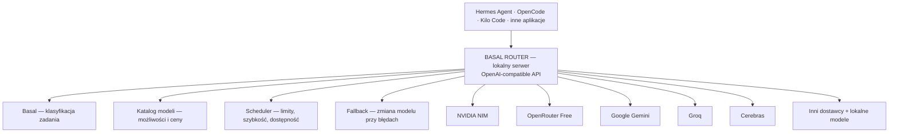

# Basal Router — jeden lokalny router AI do wszystkich aplikacji

**Tak, to jest wykonalne i Basal nadaje się do tego projektu.** Można zbudować lokalny serwer, który zbiera wszystkie Twoje darmowe API, automatycznie dobiera najlepszy dostępny model do każdego zadania i udostępnia jeden wspólny interfejs dla Hermes Agent, OpenCode, Kilo Code i innych aplikacji.

Strona projektu: [Basal](https://basal.si5.pl/).

W opisywanym rozwiązaniu Basal pełni rolę lokalnego klasyfikatora podejmującego decyzje z określonej listy możliwości, a nie zwykłego chatbota. Jego zastosowanie do routingu modeli jest więc naturalne. Pierwotny opis architektury odnosił się do Basal 2.0 i silnika 2.1; przed implementacją należy zweryfikować interfejsy używanej wersji (w tym 2.2).

> **Najważniejsze założenie:** użytkownik nie wybiera już modeli ani dostawców. Wybiera tylko „Basal Router” w swojej aplikacji, a reszta odbywa się automatycznie.

## 1. Jak powinien działać system



Router działa jako pośrednik. Nie musi sam generować odpowiedzi, ponieważ to zadanie zleca wybranemu modelowi zewnętrznemu. Lokalnie działa mechanizm decyzyjny, zarządzanie dostawcami i komunikacja API.

## 2. Jak Basal wybiera model

Ważne rozróżnienie: opisane wcześniej API Basala udostępnia `/v1/systemone`, natomiast aplikacje takie jak OpenCode oczekują `/v1/chat/completions`. Potrzebna jest dodatkowa warstwa proxy. Konkretne endpointy trzeba sprawdzić dla docelowej wersji Basala.

Proponuję sześć mechanizmów działających wspólnie:

1. **Automatyczne wykrywanie modeli.** Po dodaniu klucza API router pobiera katalog modeli danego dostawcy, sprawdza ich możliwości i identyfikuje modele dostępne bezpłatnie. Jeśli nie potrafi potwierdzić darmowego dostępu, nie aktywuje modelu automatycznie.
2. **Ocena zadania przez Basal.** Klasyfikator ustala, czy chodzi o prostą rozmowę, programowanie, debugowanie, matematykę, głębokie rozumowanie, analizę obrazu czy pracę z narzędziami agenta.
3. **Dobór najlepszego modelu.** Router eliminuje modele niespełniające wymagań, np. bez obsługi `tool_calls` lub odpowiednio długiego kontekstu. Następnie Basal wybiera spośród pozostałych, korzystając z ich rzeczywistych charakterystyk i wyników testów.
4. **Automatyczne zarządzanie limitami.** Router śledzi RPM, TPM, limity dzienne, dostępność i liczbę równoczesnych żądań. Przy odpowiedzi HTTP 429 respektuje `Retry-After` i wybiera innego dostawcę.
5. **Inteligentny fallback.** Kiedy wybrany model jest niedostępny, router wybiera najlepszy zamiennik. Musi przy tym zachować historię rozmowy, wywołania narzędzi i integralność sesji. Nie należy zmieniać modelu w środku rozpoczętego strumienia odpowiedzi.
6. **Uczenie się wydajności modeli.** System zapisuje opóźnienia, błędy i wyniki testów jakości. Dzięki temu może aktualizować preferencje wyboru modeli. Basal nie zna automatycznie jakości wszystkich nowych modeli — tę wiedzę musi otrzymać z katalogu i pomiarów.

### Przykładowe działanie

| Zadanie | Preferencja routera |
|---|---|
| Proste pytanie | Najszybszy wystarczająco dobry model |
| Pisanie strony WWW | Model dobrze oceniony w generowaniu frontendu |
| Duży refaktoring | Mocniejszy model kodujący z długim kontekstem i narzędziami |
| Skomplikowana matematyka | Najlepiej oceniany dostępny model rozumujący |
| Analiza zdjęcia | Model z obsługą vision |
| Zajęty lub zablokowany provider | Najlepszy dostępny zamiennik |

## 3. Jeden adres dla wszystkich aplikacji

Proponowany serwer lokalny:

| Parametr | Wartość |
|---|---|
| Adres API | `http://127.0.0.1:8787/v1` |
| Model | `auto` |
| Protokół | OpenAI-compatible |

To rozwiązanie jest lepsze od udawania serwera Ollama, ponieważ wszystkie trzy aplikacje obsługują własne endpointy zgodne z OpenAI. Ollama nadal może uruchamiać samego Basala.

### Przykładowa konfiguracja OpenCode

```json
{
  "$schema": "https://opencode.ai/config.json",
  "provider": {
    "basal-router": {
      "npm": "@ai-sdk/openai-compatible",
      "name": "Basal Router",
      "options": {
        "baseURL": "http://127.0.0.1:8787/v1"
      },
      "models": {
        "auto": {
          "name": "Basal Auto"
        }
      }
    }
  },
  "model": "basal-router/auto"
}
```

W **Hermes Agent** wybierasz `Custom endpoint`, w **Kilo Code** — `OpenAI Compatible`. Podajesz ten sam adres, model `auto` i ewentualny lokalny token dostępu. Konfigurujesz raz.

Powyższy JSON to przykład planowanej integracji, a nie potwierdzona konfiguracja działającego serwera.

## 4. Panel zarządzania routerem

Zbudowałbym prosty interfejs WWW dostępny lokalnie.

### Widok główny — makieta

```text
┌───────────────────────────────────────────────┐
│ Basal Router                                  │
├───────────────────────────────────────────────┤
│ Dostawcy: 6    Modele: 24    Koszt: 0 zł      │
│                 (dane przykładowe)            │
├───────────────────────────────────────────────┤
│ Dodawanie dostawcy                            │
│                                               │
│ Dostawca API: [NVIDIA NIM              ▼]      │
│ Klucz API:    [••••••••••••••••••••••••]      │
│                                               │
│ [x] Wyłącznie darmowe API                     │
│ [x] Automatyczny fallback                     │
└───────────────────────────────────────────────┘
```

Dostawcy do obsługi w formularzu:

- NVIDIA NIM
- OpenRouter
- Google Gemini
- Groq
- Cerebras
- Inny dostawca kompatybilny z OpenAI

Panel powinien dodatkowo pokazywać:

- który model wybrał Basal oraz dlaczego;
- czasy odpowiedzi i historię żądań;
- wykorzystanie limitów API;
- status dostawców i modeli;
- przełączenia awaryjne i powody błędów;
- informację, czy dany model jest potwierdzony jako darmowy.

**Bezpieczeństwo:** klucze API należy przechowywać w zabezpieczonym lokalnym magazynie, nigdy w logach ani w konfiguracjach poszczególnych agentów. Panel administracyjny powinien wymagać uwierzytelnienia, jeżeli będzie dostępny poza lokalnym hostem.

## 5. Jaką technologię zastosować

Najbardziej praktyczny zestaw to **Python + FastAPI + Basal + warstwa adapterów dostawców + SQLite**.

Do samej komunikacji z wieloma API można wykorzystać [LiteLLM](https://docs.litellm.ai/), zamiast implementować wszystkie formaty żądań od początku. Projekt obsługuje liczne API, streaming i fallback.

W pierwotnej rekomendacji wskazano użycie załatanej wersji LiteLLM **co najmniej 1.83.9** ze względu na ujawnione podatności. Przy wdrożeniu należy dodatkowo sprawdzić aktualne komunikaty bezpieczeństwa, użyć bezpiecznej wersji i bezwzględnie blokować płatne wywołania.

---

## Podsumowanie założeń

System ma działać tak, aby:

1. Użytkownik dodawał klucze swoich darmowych dostawców w jednym miejscu.
2. Aplikacje korzystały tylko z jednego lokalnego endpointu i modelu `auto`.
3. Basal automatycznie rozpoznawał zadanie i dobierał model spośród dopuszczonych kandydatów.
4. Router sam monitorował limity API, awarie i dostępność modeli.
5. Przełączenia między dostawcami odbywały się automatycznie, bez naruszania rozpoczętych odpowiedzi strumieniowych.
6. System nie wykonywał płatnych żądań bez jednoznacznego zezwolenia.
7. Panel WWW pozwalał kontrolować pracę routera i diagnozować wybory modeli.

**Status dokumentu:** opis koncepcji i proponowanej architektury, nie gotowa implementacja.
