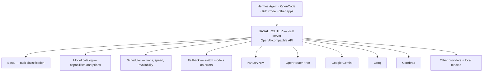

# Basal Router — one local AI router for all apps

**Yes, this is feasible and Basal fits the project.** A local server can pool your free API keys,
automatically pick the best available model for every task, and expose one shared interface for
Hermes Agent, OpenCode, Kilo Code and other apps.

Project page: [Basal](https://basal.si5.pl/).

In this design Basal acts as a local classifier that makes decisions over a defined list of options —
not as a chatbot. Its use for model routing is therefore natural. The original architecture description
referred to Basal 2.0 and the 2.1 engine; before implementing, verify the interfaces of the version you use
(this repo runs 2.2).

> **Core assumption:** the user no longer picks models or providers. They pick only "Basal Router" in
> their app; everything else happens automatically.

## 1. How the system should work



The router is a proxy. It does not generate answers itself — it delegates them to the chosen external
model. Locally it runs the decision mechanism, provider management and API communication.

## 2. How Basal picks a model

Important distinction: the Basal API exposes `/v1/systemone`, while apps like OpenCode expect
`/v1/chat/completions`. A proxy layer is needed. Verify exact endpoints for your Basal version.

Six mechanisms working together:

1. **Automatic model discovery.** After an API key is added, the router pulls the provider's model
   catalog, checks capabilities and identifies models available free of charge. If free access cannot be
   confirmed, the model is not activated automatically.
2. **Task assessment by Basal.** The classifier decides whether it is casual chat, coding, debugging,
   math, deep reasoning, image analysis or agent tool work.
3. **Best-model selection.** The router eliminates models that fail hard requirements (no `tool_calls`,
   too short context), then Basal chooses among the rest using their real characteristics and benchmark
   results.
4. **Automatic limit management.** The router tracks RPM, TPM, daily limits, availability and concurrency.
   On HTTP 429 it honours `Retry-After` and picks another provider.
5. **Intelligent fallback.** When the chosen model is unavailable the router picks the best replacement,
   preserving conversation history, tool calls and session integrity. Never switch mid-stream.
6. **Performance learning.** The system records latencies, errors and quality-test results, and updates
   model preferences. Basal does not automatically know the quality of new models — that knowledge comes
   from the catalog and from measurements.

### Example behaviour

| Task | Router preference |
|---|---|
| Simple question | The fastest sufficiently good model |
| Building a web page | A model well rated at frontend generation |
| Large refactor | A strong coding model with long context and tools |
| Hard math | The best-rated available reasoning model |
| Photo analysis | A vision-capable model |
| Busy or rate-limited provider | The best available replacement |

## 3. One address for all apps

Proposed local server:

| Setting | Value |
|---|---|
| API address | `http://127.0.0.1:8787/v1` |
| Model | `auto` |
| Protocol | OpenAI-compatible |

This beats pretending to be an Ollama server, because all three apps support custom OpenAI-compatible
endpoints. Ollama still runs Basal itself.

### Example OpenCode configuration

```json
{
  "$schema": "https://opencode.ai/config.json",
  "provider": {
    "basal-router": {
      "npm": "@ai-sdk/openai-compatible",
      "name": "Basal Router",
      "options": {
        "baseURL": "http://127.0.0.1:8787/v1"
      },
      "models": {
        "auto": {
          "name": "Basal Auto"
        }
      }
    }
  },
  "model": "basal-router/auto"
}
```

In **Hermes Agent** pick `Custom endpoint`; in **Kilo Code** pick `OpenAI Compatible`. Same address, model
`auto`, optional local access token. Configure once.

The JSON above is a planned integration example, not a verified configuration of a running server.

## 4. Router management panel

A simple local web UI:

```text
┌───────────────────────────────────────────────┐
│ Basal Router                                  │
├───────────────────────────────────────────────┤
│ Providers: 6    Models: 24    Cost: 0         │
│                 (sample data)                 │
├───────────────────────────────────────────────┤
│ Add provider                                  │
│                                               │
│ API provider: [NVIDIA NIM               ▼]     │
│ API key:      [••••••••••••••••••••••••]      │
│                                               │
│ [x] Free APIs only                           │
│ [x] Automatic fallback                       │
└───────────────────────────────────────────────┘
```

Providers to support in the form: NVIDIA NIM, OpenRouter, Google Gemini, Groq, Cerebras, any other
OpenAI-compatible provider. The panel should also show: which model Basal chose and why; response times
and request history; API limit usage; provider/model status; failovers and error reasons; whether a model
is confirmed free.

**Security:** API keys belong in a secured local store — never in logs or in per-agent configs. The admin
panel must require authentication if exposed beyond localhost.

## 5. Technology

The most practical stack: **Python + FastAPI + Basal + provider adapters + SQLite**.

For talking to many APIs, [LiteLLM](https://docs.litellm.ai/) can be used instead of writing every format
from scratch: it handles many APIs, streaming and fallback. Use at least **1.83.9** due to disclosed
vulnerabilities; check current advisories, and hard-block paid calls.

---

## Summary of assumptions

1. The user adds keys of their free providers in one place.
2. Apps talk to one local endpoint and the `auto` model.
3. Basal recognises the task and picks from the allowed candidates.
4. The router monitors API limits, failures and availability.
5. Provider switches happen automatically, without breaking in-flight streams.
6. No paid requests without explicit consent.
7. The web panel controls the router and explains its choices.

**Document status:** concept description and proposed architecture, not a finished implementation.
